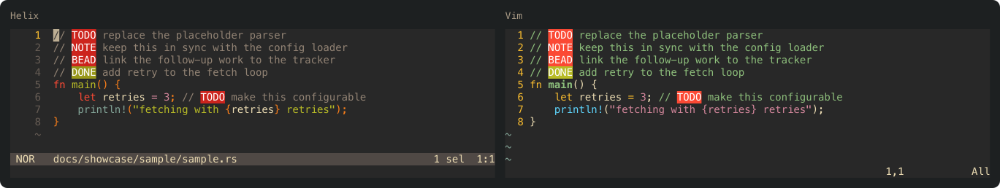

# hx-highlight

Make `TODO`, `NOTE`, `BEAD` and `DONE` markers impossible to miss in Helix and Vim, from one JSON file you edit once.



A marker is a name, a regex, and two colors:

```json
[
  {"name":"TODO","regex":"\\bTODO\\b","fg":"white","bg":"red"},
  {"name":"DONE","regex":"\\bDONE\\b","fg":"white","bg":"green"}
]
```

`hx-highlight` reads that list and writes a Helix theme, per-language Helix highlight queries, and a Vim plugin file. The screenshot above is rendered by the real `hx` and `vim` from `markers/markers.json` and the files in `docs/showcase/sample/`.

## Install

The generated files are committed, so installing needs no Rust toolchain and no build step. The repository is laid out as a Vim plugin (`plugin/`) and a Helix runtime directory (`runtime/`).

### Vim

With [vim-plug](https://github.com/junegunn/vim-plug):

```vim
Plug 'davidawad/hx-highlight'
```

Any plugin manager that adds the repository to `'runtimepath'` works the same way, as does Vim's own packages: `git clone https://github.com/davidawad/hx-highlight ~/.vim/pack/hx-highlight/start/hx-highlight`.

Vim applies the markers with `matchadd()` at buffer and window entry, so your syntax highlighting is left intact.

### Helix

Helix has no plugin manager; it reads themes and queries from its runtime directories. Clone the repository and point Helix at its `runtime/`:

```sh
git clone https://github.com/davidawad/hx-highlight ~/.local/share/hx-highlight
export HELIX_RUNTIME=~/.local/share/hx-highlight/runtime   # in your shell profile
```

Then set `theme = "hx-highlight"` in `~/.config/helix/config.toml` (it inherits `gruvbox`). `hx --health` lists the directory under "Runtime directories". Helix searches its config `runtime/` first, then `$HELIX_RUNTIME`, then the bundled runtime, so every other theme, query and grammar still comes from your installation.

If you already use `HELIX_RUNTIME`, link the files into your config runtime instead:

```sh
mkdir -p ~/.config/helix/runtime/queries ~/.config/helix/themes
ln -s ~/.local/share/hx-highlight/runtime/themes/hx-highlight.toml ~/.config/helix/themes/
ln -s ~/.local/share/hx-highlight/runtime/queries/comment ~/.local/share/hx-highlight/runtime/queries/org ~/.config/helix/runtime/queries/
```

Markers are painted in code comments (via the `comment` grammar) and in `.org` files. A user `highlights.scm` replaces Helix's bundled one rather than extending it, so the shipped queries are the bundled queries of the Helix release in [`runtime/HELIX_VERSION`](runtime/HELIX_VERSION) with the marker patterns appended. On another Helix release, regenerate them so the bundled part matches yours (this one step needs Rust):

```sh
cargo install --path .
runtime="$(hx --health | sed -n 's/^Runtime directories: //p' | tr ';' '\n' \
  | while read -r d; do [ -f "$d/queries/comment/highlights.scm" ] && echo "$d" && break; done)"
hx-highlight queries markers/markers.json "$runtime" ~/.config/helix/runtime/queries
```

## Changing the markers

Edit `markers/markers.json`, then regenerate the committed files:

```sh
hx-highlight generate markers/markers.json /tmp/hxhl
cp /tmp/hxhl/hx-highlight.vim plugin/ && cp /tmp/hxhl/hx-highlight.toml runtime/themes/
hx-highlight queries markers/markers.json "$runtime" runtime/queries
```

`cargo test` fails if a committed file no longer matches `markers/markers.json`.

## Usage

```sh
hx-highlight generate <markers.json> <output-dir>     # theme + vim file
hx-highlight queries  <markers.json> <helix-runtime> <queries-dir>
```

Add a marker by adding one entry to `markers/markers.json` and rerunning both commands. Colors are terminal color names; the Vim file maps the common names to hex for GUI Vim.

## Tests

```sh
cargo test
```

The tests compare generated files to goldens, source the Vim file in a real `vim`, and render a sample through a real `hx` in a private tmux server to check the painted colors. The real-editor tests skip when `vim`, `hx` or `tmux` is missing. The screenshot corpus and its reproduction commands are in [docs/showcase.md](docs/showcase.md).

## License

MIT, see [LICENSE](LICENSE).
