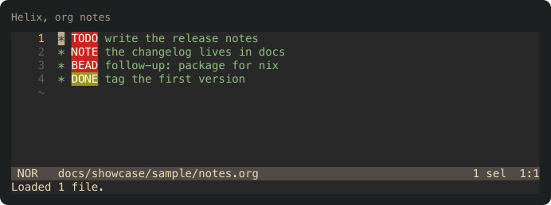

# Showcase

Every image here is rendered by the real `hx` and `vim` in a private tmux server with a throwaway config directory, from the generic files in `docs/showcase/sample/`. Reproduce all of them with:

```sh
docs/showcase/make-screenshots.sh
```

Requirements: `cargo`, `hx`, `vim`, `tmux`, `rsvg-convert`. The script builds the generator, writes the theme and queries into a temp dir, captures each pane with `tmux capture-pane -e -p`, turns the capture into SVG with `cargo run --example ansi2svg`, and converts it to PNG.

## Helix and Vim side by side

Source: `docs/showcase/sample/sample.rs`. Used at the top of the README.


## Helix, org notes

Source: `docs/showcase/sample/notes.org`.


